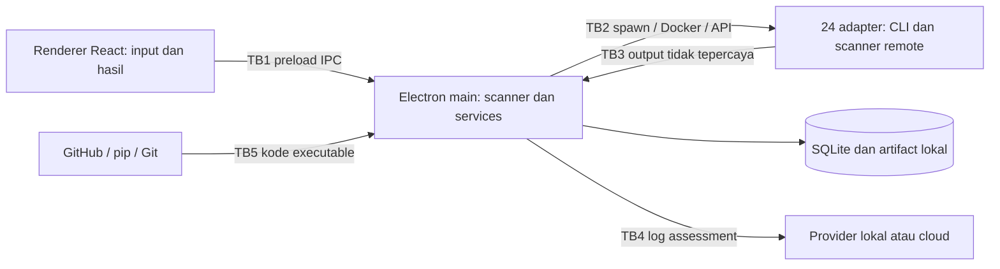

# Review Recon App — menuju enterprise grade

Tanggal: 15 Oktober 2026, Asia/Makassar. Repository: `D:\Projects\recon-app`. HEAD saat diperiksa: `6cc2b26`, dengan perubahan lokal aktif.

**Kesimpulan:** proyek ini merupakan fondasi desktop orchestration yang cukup luas, tetapi bukti saat review belum mendukung klaim enterprise grade. Prioritas utamanya adalah integritas hasil, lifecycle eksekusi, keamanan aplikasi, dan workflow assessment. Penambahan scanner harus mengikuti fondasi tersebut.

Pengguna mengonfirmasi bahwa Antigravity sedang memperbaiki kode secara bersamaan. Karena itu, temuan di bawah adalah **temuan snapshot**, bukan klaim bahwa semua masalah masih ada pada kode terbaru. Antigravity harus merekonsiliasi temuan sebelum mengimplementasikan perubahan.

## 1. Cakupan dan bukti

Ditelaah: seluruh modul utama di `src` dan `electron`, 24 adapter, preload/IPC, installer/updater, penyimpanan/SQLite, laporan, AI, Acunetix runner, konfigurasi build, README, changelog, dan dokumen rencana sebelumnya. Dependency vendored dan binary release tidak diaudit baris demi baris.

Verifikasi dilakukan tanpa scan terhadap target nyata, tanpa mengakses kredensial pengguna, tanpa menjalankan installer/updater tool, dan tanpa mengirim log ke AI. Implementasi aplikasi tidak diubah oleh review ini.

| Pemeriksaan | Hasil dan batasnya |
|---|---|
| Typecheck awal `tsc -b` | Lolos pada pembacaan awal, tetapi hanya mencakup renderer dan konfigurasi Vite; backend tidak masuk project references. |
| Typecheck snapshot renderer/project | Gagal: 2 diagnostic, termasuk import `useLogStore` yang hilang. |
| Typecheck backend tersendiri | 17 diagnostic pada dependency graph `electron/main.ts` dan `electron/preload.ts`. Ini bukan bukti bahwa 17 error tersebut semuanya menyebabkan runtime crash. |
| ESLint `src electron` pada snapshot | 27 error, 1 warning. Bukan hasil lint seluruh generated bundle. |
| Probe sintetis parser/status/report/secrets | Empat masalah berhasil direproduksi, lihat `evidence/probe-results.json`. |
| Renderer browser | Snapshot asli crash karena import hilang. Preview layout dilakukan setelah menambahkan satu import hanya pada salinan sementara. |
| Preview layout | 1366×768, 1400×900, 1920×1080; empat tema pada 1400×900. Ditemukan 18 instance xterm dan error `dimensions` pada runtime preview. |
| Scanner asli, Electron packaged app, installer NSIS/portable | Belum diuji end-to-end. Keberadaan adapter, package config, dan file release tidak membuktikan integrasi lolos. |

Snapshot sementara berada di `%TEMP%\recon-app-review-20261015`; hash sumber sebelum diagnostic patch disimpan di [snapshot-hashes.json](D:/Projects/recon-app/docs/reviews/2026-10-15/evidence/snapshot-hashes.json). Salinan renderer diperbarui sekali untuk menghindari mengambil file saat edit JSX belum selesai. Backend menggunakan snapshot tersendiri pada periode review yang sama. Tidak diasumsikan sebagai commit atomik.

Bukti: [typecheck project](D:/Projects/recon-app/docs/reviews/2026-10-15/evidence/typecheck-project.txt), [typecheck Electron](D:/Projects/recon-app/docs/reviews/2026-10-15/evidence/typecheck-electron.txt), [ESLint](D:/Projects/recon-app/docs/reviews/2026-10-15/evidence/eslint.json), [probe](D:/Projects/recon-app/docs/reviews/2026-10-15/evidence/probe-results.json), [UI](D:/Projects/recon-app/docs/reviews/2026-10-15/evidence/ui-results.json). Nomor baris berikut mengikuti snapshot dan dapat bergeser.

## 2. Fondasi yang layak dipertahankan

- React/TypeScript/Zustand cukup sesuai untuk desktop console ini. Tidak ada alasan kuat untuk rewrite framework.
- Electron sudah memakai `nodeIntegration: false` dan `contextIsolation: true`.
- Adapter interface sudah memisahkan sebagian aturan tool dari lifecycle process.
- SQLite memakai WAL, insert findings menggunakan transaction, dan query filter memakai parameter binding.
- Log IPC dibatch 100 ms, findings dikirim dalam chunk, dan tabel sudah mengambil halaman dari database.
- Empat tema berbasis CSS variables, terminal, filter temuan, history, dan export adalah bahan dasar yang berguna.
- `safeStorage` sudah mulai digunakan. Yang perlu diperbaiki adalah perilaku fallback dan batas akses secret.

## 3. Temuan prioritas

`P0` berarti penghalang kepercayaan/rilis; bukan skor CVSS. `P1` perlu diselesaikan sebelum rollout enterprise. `P2` adalah peningkatan operasional/UX. “Terbukti” merujuk probe atau runtime; “statis” merujuk alur kode yang dibaca, tanpa eksploitasi.

| ID | Prioritas / bukti | Temuan, dampak, dan tindakan |
|---|---|---|
| R01 | P0 / terbukti | **Nuclei output-parser mismatch.** [registry.ts:11](D:/Projects/recon-app/electron/services/scanners/registry.ts:11) memakai `-je`, sementara parser membaca JSON per baris. Fixture JSON array pretty menghasilkan 0 temuan; array compact berubah menjadi `Unknown/info`, kehilangan temuan high. Samakan format terikat versi dan tambahkan fixture JSON/JSONL. Flag resmi membedakan JSON dan JSONL. [Nuclei](https://github.com/projectdiscovery/nuclei#command-line-flags) |
| R02 | P0 / terbukti | **Laporan memberi assurance yang tidak didukung.** [reportService.ts:36](D:/Projects/recon-app/electron/services/reportService.ts:36) membuat fallback scan `COMPLETED`; `calculateStats([])` memberi A/0. Scan gagal, parsing gagal, target tidak terjangkau, dan hasil clean harus berbeda. Unknown scan harus error; report partial wajib menyatakan coverage dan kegagalan. |
| R03 | P1 / terbukti | **Cancel bukan terminal state yang stabil.** [storage.ts:127](D:/Projects/recon-app/electron/services/storage.ts:127) menerima `STOPPED`, lalu late `FAILED` menimpa aggregate status. Pisahkan requested cancellation dari exit reason; gunakan state machine dan finalisasi idempotent. |
| R04 | P1 / statis | **Lifecycle process belum tahan kegagalan.** [scanner.ts:307](D:/Projects/recon-app/electron/services/scanner.ts:307) memisahkan `error` dan `exit`, tanpa finalizer bersama; tidak ada deadline per tool; map scan/stat tidak dibersihkan setelah normal completion. Parse pada `exit` mendahului jaminan penutupan stdio. Gunakan `close`, flush, persist, cleanup, dan terminal state sekali saja. |
| R05 | P1 / statis | **Launch dan identitas rentan race.** [storage.ts:85](D:/Projects/recon-app/electron/services/storage.ts:85) memakai domain+timestamp detik; start dua kali bisa collision. `saveMetadata` tidak di-await; config kosong menghasilkan scan tanpa process yang tetap running. Tombol hanya mengunci status RUNNING, bukan STARTING/STOPPING. Gunakan UUID, validasi nonempty/dedup tool, atomic create, idempotency key. |
| R06 | P1 / statis | **Event bisa terlewat sebelum subscribe.** [Dashboard.tsx:247](D:/Projects/recon-app/src/pages/Dashboard.tsx:247) memasang state scanId setelah IPC start selesai; backend sudah menjalankan proses. Tool yang cepat selesai dapat mengirim event sebelum listener scan terpasang. Sediakan snapshot run + sequence event/replay atau subscribe global sebelum launch. |
| R07 | P1 / statis | **Boundary renderer-main kurang ketat.** [ipc.ts](D:/Projects/recon-app/electron/ipc.ts) belum memvalidasi sender frame dan schema runtime. [preload.ts:14](D:/Projects/recon-app/electron/preload.ts:14) meneruskan event Electron ke callback renderer. Implementasikan handler typed/validated, payload limits, event wrapper data-only, dan authorization operation. Ini kelemahan defense-in-depth, bukan klaim eksploit RCE telah terbukti. [Electron security](https://www.electronjs.org/docs/latest/tutorial/security) |
| R08 | P1 / statis | **Navigation, URL, dan path boundary.** `openExternal` menerima URL bebas; `will-navigate` memakai prefix `file://`; tidak terlihat kebijakan popup. Report/folder membangun path dari scanId tanpa containment check. Batasi external ke HTTP(S), buka artifact melalui ID milik aplikasi, cek realpath/containment, tolak navigation/popup yang tidak perlu. CSP sekarang mengizinkan inline script dan koneksi luas. |
| R09 | P1 / terbukti + statis | **Secret masih dapat menjadi plaintext.** [settings.ts:70](D:/Projects/recon-app/electron/services/settings.ts:70) mengembalikan nilai asli jika secure storage tidak tersedia; probe membuktikannya. IPC mengembalikan settings beserta secret terdekripsi; beberapa input token bertipe text. Gunakan credential reference, masked read, format ciphertext ber-versi, fail closed atau session-only saat vault gagal, dan propagasi kegagalan save. |
| R10 | P1 / statis | **Klaim local AI bertentangan dengan default.** [aiService.ts:118](D:/Projects/recon-app/electron/services/aiService.ts:118) memilih `minimax-m3:cloud`; Settings menyebut zero external cloud telemetry. Endpoint localhost tidak membuktikan inference lokal. Pisahkan local-only/remote/cloud dan tampilkan model serta tujuan data. Model cloud Ollama memang berjalan pada infrastruktur cloud. [Ollama cloud](https://docs.ollama.com/cloud) |
| R11 | P1 / statis | **Acunetix terikat lingkungan developer.** [runner:24](D:/Projects/recon-app/electron/scripts/acunetix_runner.js:24) mematikan verifikasi TLS, memiliki fallback password/container ID, selalu menyiapkan Docker meski API remote, polling tanpa overall deadline, dan tetap exit 0 setelah status remote gagal jika ekspor berhasil. Stop process lokal tidak membatalkan scan remote. Gunakan deployment mode eksplisit, CA trust, remote job ID dan API cancellation. |
| R12 | P1 / statis | **Installer belum menjamin provenance dan pemulihan.** [toolManager.ts:411](D:/Projects/recon-app/electron/services/toolManager.ts:411) mengekstrak langsung ke direktori aktif tanpa validasi checksum/signature aplikasi, staging, rollback atau lock terhadap scan. Shell invocation masih digunakan. Verifikasi sumber dan digest, pin versi, health-check hasil, serta pisahkan installer dari scan runner. |
| R13 | P1 / statis + referensi | **WhatWeb dipetakan ke paket yang belum terbukti identik.** Snapshot baru memetakan WhatWeb ke `pip install whatweb` dan `whatweb.exe`. Upstream `urbanadventurer/WhatWeb` berbasis Ruby. Jangan menganggap paket dengan nama serupa sebagai tool yang sama; gunakan distribusi/runtime upstream terverifikasi. Belum dilakukan instalasi maupun pemeriksaan isi paket PyPI tersebut. [WhatWeb upstream](https://github.com/urbanadventurer/WhatWeb) |
| R14 | P1 / statis | **Health/install status tidak konsisten.** Daftar tool terduplikasi di registry, manager, dependency list, settings, UI dan union types. `tlsx` tidak tercantum di dependency list snapshot; WPScan tersedia di defaults tetapi tidak di category editor. Updater Git mengabaikan boolean hasil; manual update bisa return true tanpa instalasi. Gunakan satu catalog dan capability state yang jujur. |
| R15 | P1 / statis | **Discovery dicampur sebagai vulnerability.** Nmap memberi medium untuk open ports; Naabu memberi low. Subdomain/endpoint/tech adalah observation/asset, bukan otomatis kelemahan. Pisahkan Asset, Observation, Finding, Evidence; simpan severity asli, confidence, CVE/CWE, parameter, lokasi, dan fingerprint. |
| R16 | P1 / statis | **Tidak ada dataflow antar-tool.** [scanner.ts:195](D:/Projects/recon-app/electron/services/scanner.ts:195) meluncurkan semua pilihan dengan target awal. Subdomain Subfinder tidak otomatis menjadi input DNSX/HTTPX/Nuclei. Buat pipeline bertipe dengan scope check pada setiap edge, rate/concurrency budget dan provenance. |
| R17 | P1 / statis | **Durability dan migrasi belum memadai.** [storage.ts:41](D:/Projects/recon-app/electron/services/storage.ts:41) hanya migrasi metadata/status jika database kosong; tidak mengimpor historical findings dan dapat skip sisa migrasi setelah kegagalan parsial. Tidak ada schema version, restore drill, recovery RUNNING saat crash atau retensi. Jadikan DB source of truth, migrasi idempotent dan artifact manifest ter-hash. |
| R18 | P2 / statis | **Beban memori dan main thread.** Parser membaca seluruh file sinkron; DB/log sinkron berjalan di main process. `rawLogs`, `scannerLogs` dan `allFindings` tidak dibatasi meski tabel paginated. `getHistory` mengambil semuanya; findings belum punya index filter yang eksplisit. Pindahkan pekerjaan berat ke worker, stream file, batasi buffer, gunakan aggregate query dan pagination. |
| R19 | P1 / runtime snapshot | **Terminal memengaruhi stabilitas seluruh app.** Snapshot kehilangan import `useLogStore`; setelah diagnostic patch, masih muncul 18 error `dimensions` dan 18 instance xterm pada idle. Jangan mengandalkan monkey patch `_core`. Audit kompatibilitas xterm/addon, lifecycle mount/resize, active-pane virtualization, replay log, dan ErrorBoundary. |
| R20 | P2 / statis | **AI belum evidence-based.** Raw log diberikan langsung ke prompt, belum ada redaction atau batas cloud payload; hasil hanya di store sementara. Ollama split chunk tanpa carry-over bisa membuang JSON yang terpotong. Report membaca `ai_analysis.txt` tetapi tidak ditemukan writer. Persist analisis beserta model/config/evidence IDs, label usulan AI, tambah framing untrusted content, timeout/cancel dan NDJSON decoder. AI sekarang pembaca log; tidak ada bukti agent otomatis menjalankan perintah. |
| R21 | P2 / statis | **Report contract lebih kecil dari klaim UI.** Modal menjanjikan CVSS distribution, raw output dan klasifikasi endpoint, sedangkan report memakai weighted severity count. Label sorted by severity tidak disertai sort pada query export. Sebagian evidence teknis tidak masuk HTML/MD. Validasi seluruh interpolasi termasuk severity, tambahkan schema version, coverage, dedup, remediation, dan disclosure metode skor. |
| R22 | P1 / pemeriksaan | **Quality gate tidak melindungi backend.** [tsconfig.node.json](D:/Projects/recon-app/tsconfig.node.json) hanya include Vite; Playwright terpasang tetapi tidak ditemukan suite test/CI repo. README, context, package version dan UI version berbeda; `build` tidak menghasilkan installer, `dist` yang menjalankan builder. Tambahkan typecheck backend, fixture tests, packaged smoke test, SBOM, release provenance dan dokumentasi faktual. |

## 4. Penilaian UI/UX

Preview menunjukkan identitas visual sudah konsisten. Perubahan terbaru yang membuat engine selector dapat dilipat membantu ruang kerja; pertahankan perbaikan itu.

Masalah yang masih terlihat/terbaca:

- Pada 1366×768, field target tertekan oleh action bar sehingga domain sulit dibaca utuh. Target harus menjadi elemen utama dengan preview scope lengkap sebelum eksekusi.
- Shortcut Tools Hub ada di sidebar, header, dan action bar. Empat pilihan tema selalu tampil, sementara pekerjaan utama adalah meninjau target dan hasil.
- Banyak tulisan 9–12 px, uppercase, tombol kecil, dan badge warna. Gunakan tipografi kerja 13–14 px, spacing konsisten, focus ring, nama aksesibel, serta severity yang tidak bergantung pada warna.
- Banyak console horizontal membuat tool tersembunyi. `pdiscovery` adalah grup tetapi filter Active membandingkannya dengan daftar tool individual, sehingga grup dapat hilang ketika tidak RUNNING.
- Status “Operational”, “Active”, dan jumlah selected tools bukan health aktual atau jumlah process berjalan. Pisahkan selected, available, queued, running, failed, skipped.
- Dashboard berpusat pada console. Enterprise assessment membutuhkan halaman Project/Engagement, Assets, Runs, Findings, Reports dan Integrations.
- History belum menyediakan pembacaan ulang detail run/findings di aplikasi, perbandingan baseline, atau retest dengan konfigurasi asal. Re-Scan hanya mengganti URL.
- Summary total menggunakan Nuclei+Wapiti, bukan aggregate 24 adapter. Pengguna bisa melihat angka berbeda pada summary, table, dan report.
- Empty state tabel tidak membedakan loading, scan belum selesai, error parser, dan tidak ada hasil pencarian. Hindari pesan yang menyiratkan keamanan telah diverifikasi.
- Dialog belum menunjukkan implementasi focus trap/return focus/keyboard semantics yang lengkap; format picker memakai clickable div. Perlu keyboard test dan automated accessibility check.
- Tema Obsidian memakai foreground putih di accent cyan; perlu contrast measurement. Screenshot visual saja bukan audit WCAG.

Contoh preview diagnostik: [dark 1366](D:/Projects/recon-app/docs/reviews/2026-10-15/evidence/dashboard-dark-1366.png), [light 1400](D:/Projects/recon-app/docs/reviews/2026-10-15/evidence/dashboard-light-1400.png), [obsidian](D:/Projects/recon-app/docs/reviews/2026-10-15/evidence/dashboard-obsidian-1400.png), [glass](D:/Projects/recon-app/docs/reviews/2026-10-15/evidence/dashboard-glass-1400.png). Screenshot memakai read-only mock IPC dan diagnostic import patch; bukan bukti integrasi Electron lolos.

## 5. Inventaris kemampuan sekarang

Seluruh item berikut memiliki adapter; tingkat dukungan harus dibuktikan per versi. Tidak tepat memasukkan tool ini sebagai “tool baru yang belum ada”.

| Kelompok | Tool yang ada | Peningkatan yang dibutuhkan |
|---|---|---|
| Discovery | Subfinder, AlterX, DNSX, HTTPX, Katana, GAU | Pipeline hasil, scope filtering, asset inventory. GAU saat ini diringkas menjadi jumlah/sample, sehingga detail tidak dimanfaatkan workflow. |
| Network/TLS | Naabu, Nmap, TLSX | Model service/port/certificate; Nmap XML; findings berdasarkan bukti kelemahan, bukan open port saja. |
| Web DAST | Nuclei, Wapiti, ZAP, Dalfox, Corsy, CRLFsuite | Fixture output, version compatibility, authenticated scan, evidence, timeout dan cancellation. |
| Fingerprinting/CMS | Wafw00f, WhatWeb, CMSeeK, WPScan | Runtime yang benar, routing berdasarkan tech detection, confidence, WPScan policy dan lisensi, output CMSeeK yang terisolasi per run. |
| Discovery/fuzzing endpoint | FFUF, Arjun | Wordlist preflight, parameter schema, bounded request budget, endpoint dataflow. Parser Arjun perlu divalidasi terhadap output versi nyata. |
| Komersial | HCL AppScan, Invicti/Netsparker, Acunetix | Capability/licensing preflight, fixture vendor, remote job lifecycle, authenticated profile. Integrasi komersial tidak otomatis membuat host app enterprise grade. |

## 6. Tool tambahan berdasarkan gap

Rekomendasi ini adalah pilihan desain, bukan klaim bahwa semua tool harus dipasang. Konfirmasi release, lisensi, provenance dan dukungan Windows saat implementasi; gunakan versi yang dipin dan diuji.

| Urutan | Tambahan | Nilai dan trade-off |
|---|---|---|
| 1 | **SSLyze** | Audit konfigurasi TLS/certificate yang lebih dalam dari inventory TLSX. Cukup satu TLS audit engine lebih dulu. Python runtime dan opsi kebijakan perlu dikelola. [Upstream](https://github.com/nabla-c0d3/sslyze) |
| 2 | **Gitleaks** | Secret detection pada repo/directory dan history sesuai mode. Butuh redaction kuat: jangan memajang atau mengekspor secret utuh. [Upstream](https://github.com/gitleaks/gitleaks/blob/master/README.md) |
| 3 | **Semgrep** | SAST menambah coverage sebelum aplikasi berjalan. Target menjadi repo/path; rule provenance dan batas dukungan engine perlu jelas. [Dokumentasi](https://docs.semgrep.dev/running-rules) |
| 4 | **Trivy** | Container/filesystem vulnerabilities, misconfiguration, secrets dan SBOM. Prioritaskan satu jalur container/filesystem, jangan otomatis scan seluruh host. Overlap secret dengan Gitleaks harus ditangani. [Container target](https://www.trivy.dev/docs/v0.68/guide/target/container_image/), [secret scanning](https://www.trivy.dev/docs/latest/guide/scanner/secret/) |
| 5 | **Schemathesis** | Pengujian berbasis schema API untuk melengkapi DAST. Kegagalan property/schema bukan otomatis security vulnerability. Operasi API yang mengubah data harus dibatasi oleh profil dan target test. [Upstream](https://github.com/schemathesis/schemathesis) |
| 6, opsional | **Prowler** | Cloud posture ketika scope cloud memang dibutuhkan. Membutuhkan identity/role read-only, account scope dan policy tersendiri; jangan dimasukkan default web scan. [Dokumentasi](https://docs.prowler.com/introduction) |

**Perdalam integrasi yang sudah ada:** ZAP Automation Framework untuk autentikasi, environment/context, OpenAPI dan report; nilainya lebih besar daripada menambah scanner web serupa tanpa workflow. [ZAP Automation Framework](https://www.zaproxy.org/docs/automate/automation-framework/)

Berikutnya, sediakan report import dan integrasi findings/ticketing melalui connector. Import-only untuk tool/vendor yang lisensinya tidak tersedia tetap berguna, tetapi harus diberi label import-only. Enrichment CVE memakai EPSS sebagai sinyal probabilitas eksploitasi, bukan severity atau bukti exploit; simpan waktu dan sumber data. [FIRST EPSS](https://www.first.org/epss/)

## 7. Arsitektur dan batas kepercayaan

Alur saat ini:

Prioritas atribut bisnis: **hasil dapat dipercaya**, **run dapat direkonstruksi**, **data sensitif terkendali**, **eksekusi terbatasi**, **mudah dipulihkan**, dan **dapat dioperasikan tim**.

| Boundary | Ancaman / kategori | Kontrol yang berhubungan langsung |
|---|---|---|
| TB1 renderer-main | Pemalsuan pemanggil, manipulasi config, privilege escalation (STRIDE) | Sender-frame check, runtime schema, capability API sempit, limit payload, secret masking. |
| TB2 runner-target | Eksekusi di luar scope, pemborosan resource, remote job yatim (tampering/DoS) | Scope policy setiap dispatch, budgets, process-tree/container/remote cancellation, timeout. |
| TB3 output hasil | Manipulasi report, parser exhaustion, misleading evidence (tampering/DoS) | Streaming bounded parser, schema validation, error visibility, escaped export, evidence provenance. |
| TB4 AI | Kebocoran data dan instruksi berbahaya dari target (information disclosure; AI context poisoning) | Redaction, local-only policy, input sebagai data tidak tepercaya, evidence citations, tanpa execute capability. |
| TB5 software update | Paket/binary salah atau berubah (supply-chain tampering) | Approved source, pinned release/digest, signature bila tersedia, staging/rollback, audit update. |
| Storage/evidence | Hilangnya history, perubahan bukti tanpa jejak (repudiation/tampering) | Transaction, migration ledger, backup/restore, hash manifest, audit event. Hash lokal sendiri tidak tahan admin yang memodifikasi seluruh penyimpanan. |

Arsitektur tujuan awal: renderer tetap tipis; Electron main menjadi broker; job runner terpisah menggunakan worker/utility process; database/evidence service lokal; adapter manifest terpusat; typed workflow graph. SQLite tetap layak untuk satu workstation apabila aksesnya ditata dan diuji.

Untuk deployment multiuser, tambahkan coordinator/service tersendiri dengan database server, identity/SSO, RBAC yang enforced di backend, audit terpusat dan worker identity. Tombol “role admin” di localStorage tidak memenuhi kebutuhan tersebut. Jangan memaksa Kubernetes/microservices pada fase desktop pertama.

## 8. Urutan pengembangan

1. **Stabilisasi dan rekonsiliasi:** cocokkan review dengan perbaikan aktif, perbaiki false assurance, parsing, cancellation, typecheck, runtime crash.
2. **Fondasi execution dan data:** typed catalog, reliable job model, scope, log/evidence durability, schema migration dan vault.
3. **Workflow dan UX:** engagement/assets/runs/findings/report, pipeline, profile, auth, history/retest/diff.
4. **Coverage tambahan:** SSLyze dan Gitleaks dahulu; Semgrep/Trivy setelah target repo/image; Schemathesis setelah API workflow.
5. **Operasional enterprise:** signed release, offline bundle, proxy/CA, backup/restore, telemetry lokal, update rollback, connector dengan retry/idempotency.
6. **Team mode jika dibutuhkan:** coordinator, server-side authorization, SSO dan remote workers; acceptance tersendiri.

Kriteria selesai harus mengukur konsistensi findings, bukti scan coverage, kebersihan pembatalan, pemulihan setelah crash, kompatibilitas versi tool, dan pengalaman pengguna. Screenshot bagus atau build hijau saja tidak cukup.

Prompt implementasi terperinci tersedia di [ANTIGRAVITY-PROMPT.md](D:/Projects/recon-app/docs/reviews/2026-10-15/ANTIGRAVITY-PROMPT.md).
